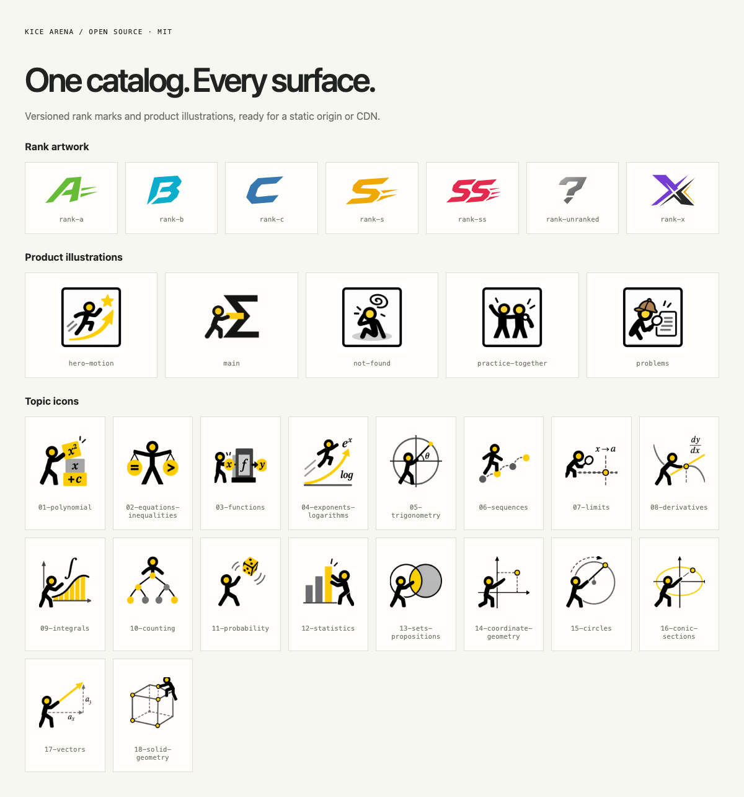

# @kicearena/assets

KICE Arena's rank SVGs, page illustrations and topic icons in one versioned catalog.

[MIT](LICENSE) · ESM + TypeScript · Browser / Node / Vite



## Use

GitHub Packages requires a read:packages credential even for public npm packages. Set `NODE_AUTH_TOKEN` and this project `.npmrc`:

```ini
@kicearena:registry=https://npm.pkg.github.com
//npm.pkg.github.com/:_authToken=${NODE_AUTH_TOKEN}
```

```sh
bun add --exact @kicearena/assets@0.1.0
```

```ts
import { assetUrl, PAGE_ICON_URLS, RANK_ICON_URLS } from "@kicearena/assets";
const badge = RANK_ICON_URLS.ss;
const logo = PAGE_ICON_URLS.main;
const cdn = assetUrl("ranks/rank-ss", "https://cdn.example.com");
```

Vite consumers add `kiceAssets()` from `@kicearena/assets/vite` to their plugins. It serves assets during development and emits original bytes into `dist/kice-assets/0.1.0/`. Use `__KICE_MAIN_ICON__` in HTML templates to resolve the same catalog logo. Other build systems can copy `assetDirectory` from `@kicearena/assets/node` to that versioned static path. `assetFilePath(id)` resolves installed files without depending on the application checkout.

## CDN contract

Upload the emitted `kice-assets/0.1.0` directory unchanged. The optional CDN origin changes the host only; URLs retain the version and relative filename. Serve immutable versions with `Cache-Control: public, max-age=31536000, immutable`. Never overwrite a published version. [catalog.json](catalog.json) includes size, SHA-256 and media type for all 49 files. CORS is only needed for canvas pixel access; a CDN rollout is separate from installing this package.

## Gallery and development

```sh
bun install --frozen-lockfile
bun run demo
bun run check
bun run test
bun run build
bun run demo:build
```

The gallery uses the real catalog. Tests decode all assets and check original hashes, CDN paths, dev serving, HEAD, missing paths and the standalone build. [Provenance](provenance/kice-assets.json) records source paths and hashes. Rating thresholds, rank selection, profile choices and topic taxonomy belong to the consuming application.

## License

[MIT](LICENSE) © 2026 KICE Arena contributors. Third-party provider symbols and fonts are not part of this package; they retain their own ownership and licenses in the application. The KICE name and marks do not imply endorsement.
